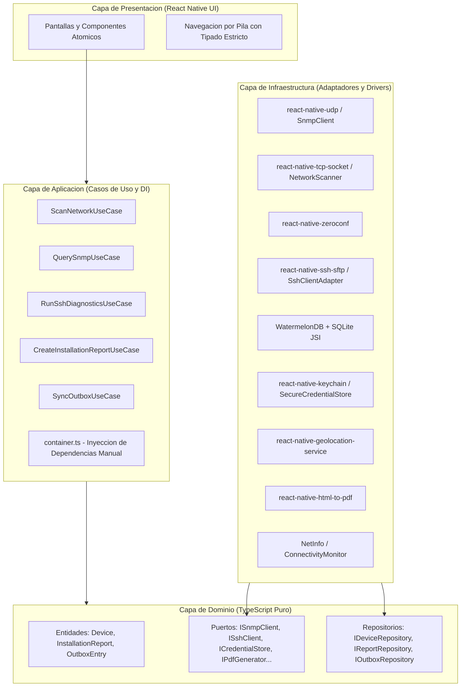

# Network Diagnostics Suite

> **Toolkit movil de diagnostico de infraestructura de telecomunicaciones para tecnicos de campo**  
> *Carrera: Licenciatura en Sistemas de Informacion — Desarrollo de Aplicaciones Moviles (2026)*  
> *Facultad de Ciencia y Tecnologia (FCyT), Sede Concepcion del Uruguay — UADER*  
> *Trabajo Practico N° 6: Redes y Telecomunicaciones / Operaciones de Campo Offline-First*

---

## 1. Resumen Ejecutivo

**Network Diagnostics Suite** es una solucion movil orientada a operaciones de campo, desarrollada con React Native CLI bajo una arquitectura estrictamente *offline-first*. Fue concebida para tecnicos de telecomunicaciones que realizan tareas de instalacion, auditoria y mantenimiento sobre equipamiento de red en terreno (ONTs de fibra optica, routers de distribucion, switches gestionados y radioenlaces punto a punto).

Dado que estos entornos operativos presentan frecuentemente conectividad celular nula o intermitente (subsuelos, azoteas, areas rurales y gabinetes metalicos), la aplicacion:
- Prescinde de abstracciones HTTP convencionales para interactuar directamente a nivel de transporte mediante **sockets TCP/UDP crudos**.
- Decodifica e interpreta paquetes binarios **SNMP v1/v2c** a traves de un motor BER/ASN.1 propio en TypeScript puro.
- Ejecuta rutinas de diagnostico remoto mediante un cliente **SSH embebido** con credenciales protegidas en el hardware criptografico del dispositivo.
- Asocia hardware en sitio mediante lectura nativa de **codigos QR y de barras**.
- Registra instalaciones georreferenciadas con evidencia fotografica y coordenadas GPS, compilando informes tecnicos en **PDF local**.
- Garantiza la resiliencia operativa y la entrega de datos diferida mediante una base de datos SQLite reactiva (**WatermelonDB**) y una cola persistida bajo el **Patron Outbox**.

---

## 2. Matriz de Cumplimiento de Requisitos Funcionales

| ID | Requisito | Estado | Detalle Tecnico de Implementacion |
| :--- | :--- | :---: | :--- |
| **RF-01** | **Escaneo de Red Local** | Implementado | Descubrimiento hibrido: resolucion pasiva mDNS/Bonjour via `react-native-zeroconf` y sondeo activo TCP concurrente (`react-native-tcp-socket`) en puertos `80, 443, 22, 8080, 161`. Incluye resolucion de direcciones MAC y hostnames sin requerir permisos de superusuario (root). |
| **RF-02** | **Consulta SNMP v1/v2c** | Implementado | Parser BER/ASN.1 propio en TypeScript puro (`SnmpPduCodec.ts`) sobre UDP/161 (`react-native-udp`). Emite `GetRequest` para OIDs de sistema (`sysName`, `sysDescr`, `sysUpTime`, `sysLocation`) y calcula metricas de trafico de interfaces de red (`ifInOctets`, `ifOutOctets`, `ifOperStatus`) expresadas en megabytes. |
| **RF-03** | **Diagnostico Remoto SSH** | Implementado | Ejecucion de comandos predefinidos de auditoria (`uptime`, `uname -a`, `ifconfig / ip addr`, `netstat / ip route`, `df -h`, `top`) via `react-native-ssh-sftp`. Las credenciales se almacenan bajo cifrado seguro en el enclave de la plataforma (`react-native-keychain` / Android Keystore) cumpliendo OWASP MASVS M9. |
| **RF-04** | **Identificacion QR / Barras** | Implementado | Escaneo de identificadores y placas tecnicas utilizando `react-native-vision-camera` con `useCodeScanner` nativo. Vinculacion automatica de URLs de fichas tecnicas y numero de activo (Asset Tag) al registro local del equipo. |
| **RF-05** | **Registro de Instalacion** | Implementado | Captura de evidencia fotografica (`react-native-image-picker`), geolocalizacion precisa con latitud, longitud y precision (`react-native-geolocation-service`) y notas de instalacion en campo. |
| **RF-06** | **Reporte de Instalacion en PDF** | Implementado | Motor de renderizado y compilacion de informes PDF locales (`react-native-html-to-pdf`) con hoja de estilos profesional, fotos incrustadas, metadatos del sitio, datos del tecnico y coordenadas GPS. |
| **RF-07** | **Modo Offline y Cola Outbox** | Implementado | Persistencia local en SQLite mediante `WatermelonDB`. Cola de salida (Outbox) con reintentos automaticos (maximo 3), retroceso exponencial y sincronizacion desatendida ante recuperacion de enlace detectada por `@react-native-community/netinfo`. |
| **RF-08** | **Historial Local de Diagnosticos** | Implementado | Consulta integral sin conexion de auditorias tecnicas pasadas, reportes de instalacion generados e historial por nodo o equipo (`DeviceDetailScreen` y `ReportsScreen`). |

---

## 3. Arquitectura del Software

El proyecto aplica los principios de **Clean Architecture** (Arquitectura Hexagonal / Puertos y Adaptadores) y diseno guiado por responsabilidades (**SOLID**), aislando completamente el modelo de dominio de las librerias nativas de React Native:



### Estructura de Directorios

```text
src/
├── domain/                      # Capa de Dominio (TypeScript puro, 0 dependencias externas)
│   ├── entities/                # Modelos de negocio: Device, InstallationReport, OutboxEntry, DiagnosticSnapshot
│   ├── ports/                   # Contratos de adaptadores: ISnmpClient, ISshClient, ICredentialStore...
│   └── repositories/            # Contratos de persistencia: IDeviceRepository, IReportRepository, IOutboxRepository
│
├── infrastructure/              # Capa de Infraestructura (Adaptadores a librerias y SO)
│   ├── database/                # Esquemas y modelos SQLite WatermelonDB
│   ├── location/                # GeolocationAdapter (GPS nativo de alta precision)
│   ├── network/                 # NetworkScanner (Sondeo TCP concurrente y Zeroconf mDNS)
│   ├── protocols/
│   │   ├── snmp/                # SnmpClient y SnmpPduCodec (Motor BER/ASN.1 propio)
│   │   └── ssh/                 # SshClientAdapter (Wrapper SSH sobre Android Keystore)
│   ├── reporting/               # PdfGeneratorAdapter (Compilador de informes PDF nativo)
│   ├── repositories/            # Implementacion de repositorios con WatermelonDB
│   ├── security/                # SecureCredentialStore (Almacenamiento seguro Keychain/Keystore)
│   └── sync/                    # ConnectivityMonitor (Listener de red NetInfo)
│
├── application/                 # Capa de Aplicacion (Casos de Uso y Orquestacion)
│   ├── container.ts             # Inyeccion de Dependencias manual y cableado de adaptadores
│   ├── templates/               # Plantilla HTML para generacion de reportes PDF
│   └── usecases/                # ScanNetwork, QuerySnmp, RunSshDiagnostics, CreateInstallationReport, SyncOutbox
│
└── presentation/                # Capa de Presentacion (Interfaz React Native)
    ├── components/
    │   ├── atoms/               # Button, Card, Badge, Metric, Input, SectionHeader
    │   └── molecules/           # DeviceCard, ScanProgressBar
    ├── navigation/              # AppNavigator tipado con RootStackParamList
    ├── screens/                 # Dashboard, DeviceScan, DeviceDetail, SnmpQuery, SshDiagnostics, QrScanner, CreateReport, Reports
    └── theme/                   # Tokens de diseno, tipografia y paleta oscura de alto contraste
```

---

## 4. Ciclo Operativo Offline y Patron Outbox (RF-07)

Cuando el tecnico opera sin cobertura celular, el sistema garantiza la integridad de los datos evitando perdidas de informacion mediante el patron Outbox:

```text
[Accion en Terreno]
        │
        ▼
[Caso de Uso de Aplicacion]
        │
        ├───> 1. Persistencia local inmediata en SQLite (WatermelonDB)
        └───> 2. Alta de registro en 'outbox_entries' (Estado: 'pending')
                    │
                    ▼
          [ConnectivityMonitor (NetInfo)]
                    │
        ┌───────────┴───────────┐
        ▼ (Sin senal)           ▼ (Conexion restablecida)
[Permanece en cola local]   [Ejecucion automatica de SyncOutboxUseCase]
                                │
                                ▼
                    [POST /sync/:type hacia Backend / Stub]
                                │
                    ┌───────────┴───────────┐
                    ▼ (200 OK)              ▼ (Error / Timeout)
            [Marcar 'synced']        [Incrementar contador de intentos]
                    │                       │
            [Borrado de cola]        [Reintento programado (Max 3)]
```

---

## 5. Requisitos del Entorno

> [!IMPORTANT]
> **Justificacion Tecnica: React Native CLI Nativo vs. Expo Go**  
> Esta aplicacion utiliza APIs de bajo nivel para sockets TCP/UDP crudos (`react-native-tcp-socket`, `react-native-udp`), clientes SSH nativos (`react-native-ssh-sftp`), procesadores de camara en tiempo real (`react-native-vision-camera`) y almacenamiento seguro en hardware criptografico (`react-native-keychain`). **Ninguno de estos modulos puede ejecutarse dentro de Expo Go**, por lo que el proyecto requiere React Native CLI y compilacion nativa con Android Gradle / NDK.

- **Node.js**: Version 20.x o 22.x LTS.
- **Java Development Kit**: JDK 17 o JDK 21 / 25 (incluido en Android Studio en `jbr/`).
- **Android SDK**: API 34 o 35, Build-Tools 34.0.0+, Android NDK 27+.
- **Herramientas de consola**: `adb` accesible en PATH.
- **Dispositivo o Emulador**: Android 11+ con Depuracion USB activada.

---

## 6. Instrucciones de Ejecucion

### Opcion A: Instalacion Directa del APK Precompilado (Recomendado)

1. Iniciar el servidor stub de sincronizacion en la PC:
   ```bash
   node backend-stub.js
   ```

2. Conectar el telefono por cable USB (con Depuracion USB activada) o iniciar un emulador Android, y ejecutar:
   ```bash
   adb install -r NetworkDiagnosticsSuite.apk
   ```

3. Redirigir el puerto del backend para que el dispositivo acceda al stub local:
   ```bash
   adb reverse tcp:3000 tcp:3000
   ```

---

### Opcion B: Ejecucion en Modo Desarrollo

1. Instalar dependencias:
   ```bash
   npm install --legacy-peer-deps
   ```

2. Iniciar el backend stub en una terminal:
   ```bash
   node backend-stub.js
   ```

3. Redirigir puertos en ADB (Metro bundler y API backend):
   ```bash
   adb reverse tcp:8081 tcp:8081
   adb reverse tcp:3000 tcp:3000
   ```

4. Iniciar el bundler de Metro:
   ```bash
   npm start
   ```

5. Compilar y lanzar en Android (en otra terminal):
   ```bash
   npm run android
   ```

---

### Opcion C: Compilar un Nuevo APK de Produccion

Para generar un nuevo archivo APK independiente desde el codigo fuente:

```bash
cd android
./gradlew assembleRelease
```
*(En Windows PowerShell: `.\gradlew.bat assembleRelease`)*

El archivo generado se encontrara en:  
`android/app/build/outputs/apk/release/app-release.apk`

---

## 7. Backend Stub de Sincronizacion

El archivo [`backend-stub.js`](backend-stub.js) es un servidor HTTP ligero en Node.js sin dependencias externas que simula el endpoint corporativo central.

### Endpoints Disponibles

| Metodo | Ruta | Descripcion |
| :--- | :--- | :--- |
| `POST` | `/sync/report` | Recibe informes de instalacion con fotos en Base64, notas y coordenadas GPS. |
| `POST` | `/sync/diagnostic` | Recibe instantaneas de diagnostico (SNMP / SSH / puertos). |
| `POST` | `/sync/device_update` | Recibe altas y actualizaciones de equipos descubiertos en campo. |
| `GET` | `/sync/status` | Retorna contadores de recepcion y estado en formato JSON. |

*Nota de resiliencia*: El servidor stub incluye una simulacion de fallo del 10% para verificar la politica de reintentos y retroceso exponencial del Outbox.

---

## 8. Protocolo de Pruebas y Validacion End-to-End

Guia paso a paso para verificar el funcionamiento integral de la aplicacion:

1. **Estado General (Dashboard)**:
   - Al iniciar la app, observar el indicador de conectividad superior (Online / Offline).
   - El panel muestra contadores en tiempo real de Dispositivos, Reportes generados y Sincronizaciones pendientes.
2. **Descubrimiento de Red (RF-01)**:
   - Presionar **Scan Network**.
   - Ingresar rango de subred (ej. `192.168.1.0/24`) y pulsar **Start Scan**.
   - Se listaran los dispositivos descubiertos con IP, MAC y puertos abiertos.
3. **Consulta SNMP (RF-02)**:
   - Seleccionar un equipo o ingresar a **SNMP Query**.
   - Indicar IP y comunidad (por defecto: `public`).
   - Validar la recepcion de `sysName`, `sysDescr`, `sysUpTime` y metricas de trafico de interfaces de red calculadas en MB.
4. **Diagnostico SSH Remoto (RF-03)**:
   - Acceder a **SSH Diagnostics**.
   - Cargar usuario y contrasena; presionar **Save Credentials Securely** para resguardarlas en el Keystore.
   - Presionar **Run Diagnostics** y observar la ejecucion de `uptime`, `uname`, `ifconfig`, `ip route` y `df`.
5. **Lectura de Codigo QR / Barras (RF-04)**:
   - Acceder a **QR Scanner** y apuntar a un codigo para asociar el identificador de activo (Asset Tag) o ficha tecnica.
6. **Reporte de Instalacion y PDF (RF-05 y RF-06)**:
   - Ingresar a **New Installation Report**.
   - Completar nombre de sitio, tecnico, notas, adjuntar fotos y capturar la coordenada GPS actual.
   - Presionar **Save & Generate PDF Report**. Se generara y visualizara la ruta del PDF local compilado.
7. **Prueba de Cola Offline (RF-07)**:
   - Activar el **Modo Avion** en el dispositivo. La app indicara estado Offline.
   - Crear un reporte nuevo; se observara el incremento en el contador **Pending Sync**.
   - Desactivar el Modo Avion. NetInfo detectara la conexion y disparara la sincronizacion desatendida hacia el backend stub.
8. **Historial Local (RF-08)**:
   - Acceder a **Installation Reports** o al detalle de un equipo para consultar todo el historial persistido sin conexion.

---

## 9. Verificacion Automatizada y Suites de Pruebas

El proyecto cuenta con pruebas unitarias que validan la codificacion y decodificacion de PDUs SNMP, construccion de paquetes BER y tipos de datos:

```bash
# Ejecutar tests automatizados con Jest
npm test

# Verificacion estatica de tipos con TypeScript
npx tsc --noEmit
```

Ambos comandos deben reportar 0 errores y el 100% de las pruebas superadas.

---

## 10. Entregables del Trabajo Practico N° 6

1. **Codigo fuente en Git**: Repositorio completo con historial de commits convencionales.
2. **Build ejecutable (APK)**: Archivo independiente `NetworkDiagnosticsSuite.apk`.
3. **Documento Tecnico Formal**: [`TECHNICAL_DOC.md`](TECHNICAL_DOC.md) con especificacion de BER/ASN.1 SNMP, almacenamiento seguro de credenciales bajo OWASP M9 y arquitectura Outbox.
4. **Backend Minimo de Sincronizacion**: Implementado en [`backend-stub.js`](backend-stub.js).

---

## 11. Referencias y Bibliografia

- **RFC 1157**: *Simple Network Management Protocol (SNMP)*.
- **RFC 1213**: *Management Information Base for Network Management of TCP/IP-based internets: MIB-II*.
- **Martin Fowler**: *Offline-First Architecture & The Outbox Pattern*.
- **OWASP Mobile Application Security Verification Standard (MASVS)**: *M9 — Insecure Data Storage*.
- **WatermelonDB Documentation**: *Reactive & Asynchronous Database for React Native*.
